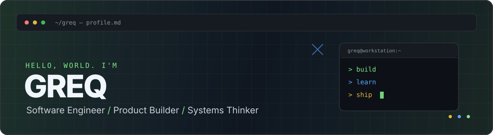

  
   
  <h3>Software Engineer · Product Builder · Systems Thinker</h3>
  

    I turn ideas into software — from product architecture and APIs to deployment and automation.
  

  

    
    
    
  

---

## `$ whoami`

I'm **Greq**, a software engineer focused on building products, backend systems and practical automation. I enjoy taking an idea from the first architecture sketch to a working application — including the API, infrastructure and the details that make the whole system reliable.

My main interests are **AI agents, developer tools, automation, web applications and IoT**. I prefer understanding the whole system rather than treating the frontend, backend and infrastructure as separate worlds.

## `// currently building`

<table>
  <tr>
    <td width="50%" valign="top">
      <h3><a href="https://moxord.com">Moxord</a></h3>
      
<strong>AI-powered Discord management</strong>

      
A platform built around AI-assisted server management, hosted MCP tools and workflow automation.

      Focus: AI agents · MCP · Discord · automation
    </td>
    <td width="50%" valign="top">
      <h3><a href="https://zlecono.com">Zlecono</a></h3>
      
<strong>Work order management</strong>

      
A system for creating, assigning, executing and documenting work — with a clear history of every order.

      Focus: product engineering · APIs · PWA · traceability
    </td>
  </tr>
  <tr>
    <td colspan="2" valign="top">
      <h3>Smart Home Lab</h3>
      
<strong>Building a smart home ecosystem</strong>

      
Exploring custom hardware and software built around ESP32 / ESP8266, with our own control logic, backend and interface.

      Focus: IoT · embedded systems · ESP32 · ESP8266
    </td>
  </tr>
</table>

## `// technology_stack`

  
  
  
  
  
  
  
  
  
  

| Area | Tools & technologies |
| --- | --- |
| **Frontend** | JavaScript, TypeScript, React, Next.js, PWA |
| **Backend** | Node.js, REST APIs, Discord integrations, MCP |
| **Data** | MongoDB |
| **Infrastructure** | Linux, VPS, Cloudflare, PM2, Tailscale |
| **IoT** | ESP32, ESP8266 |

## `// github_activity`

  
  
   
  

## `// beyond_the_code`

- I like building complete products, not just isolated features.
- I'm interested in AI systems, automation, infrastructure and the engineering behind reliable software.
- I enjoy experimenting with hardware and connecting software with the physical world.

   
  <strong>Build with purpose. Keep learning. Ship what matters.</strong>
    
  <a href="https://moxord.com">Moxord</a> · <a href="https://zlecono.com">Zlecono</a> · <a href="https://github.com/greqcja">GitHub</a>
    
  

